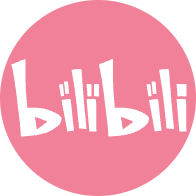
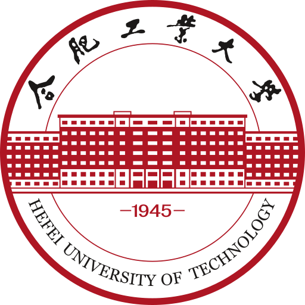

  

<h1 align="center">CozyOct1 的作品集</h1>

  AI 应用开发 · LLM Agent · RAG 系统 · 后端工程 · 开发者工具

  <a href="https://cozyoct1.github.io/">个人主页</a>
  ·
  <a href="https://github.com/CozyOct1">GitHub</a>
  ·
  <a href="https://cozyoct1.github.io/codepilot">CodePilot</a>
  ·
  <a href="https://cozyoct1.github.io/MiniKV">MiniKV</a>
  ·
  <a href="https://cozyoct1.github.io/MiniRPC">MiniRPC</a>

---

## 关于我

我关注 AI 应用从原型到可用系统的完整链路，主要方向包括 LLM Agent、RAG 检索增强、MCP 工具调用、多 Agent 协作、后端服务、数据存储和可观测性建设。

- 浙江大学人工智能方向硕士在读。
- 曾在 Bilibili AI 平台参与大模型与 AIGC 相关业务研发。
- 具备 Python 后端、AI 应用编排、向量检索、数据库、缓存、消息队列、容器化和监控等工程经验。
- 喜欢构建能真实解决问题的工具型项目，包括代码助手、医学多模态 Agent、KV 存储引擎和 RPC 框架。

## 技术栈

**AI 应用开发**

**后端与数据系统**

**工程化与部署**

---

## 代表作品

### [CodePilot](https://cozyoct1.github.io/codepilot) · 私有代码仓库智能开发助手

基于 FastAPI、LangGraph、Chroma、SQLite 和 MCP 构建的本地代码仓库 Agent 系统，支持 CLI、HTTP API 和 Web 控制台多入口。它可以对本地仓库进行索引、问答、任务创建、ReAct Agent 执行、安全工具调用、记忆检索、任务持久化和 Prometheus 指标暴露。

**核心能力**

- 基于 LangGraph 构建结构化 Agent 执行流，将仓库检索、短期记忆、长期记忆、项目级指令、ReAct 规划和工具执行拆分为可追踪节点。
- 基于 Chroma 构建本地仓库索引和长期记忆库，支持 Python、Markdown、JSON、YAML、前端源码等多类型文件检索。
- 实现文件系统、Shell、Git 等安全工具调用，将访问范围限制在目标仓库内，并拦截高风险命令。
- 基于 SQLite、SQLModel 和 SQLAlchemy 实现任务、会话、消息、工具调用和文件变更记录持久化。
- 针对 FastAPI + SQLite 任务创建链路进行并发优化，在 20 并发 300 请求场景下达到 100% 成功率、146.09 req/s 吞吐和 668 ms P95 延迟。

### MyoDino · 近视性黄斑病变多模态分级 Agent 系统

面向眼科辅助诊断场景的多模态 Agent 系统，基于 DINOv3、Qwen2.5-VL、LangChain、RAG 和 MySQL 构建，支持眼底图像 ATN 分级、患者主诉理解、医学知识增强问答、长期记忆管理和 Markdown 结构化报告生成。

**核心能力**

- 基于 DINOv3 ViT-B/16 构建多任务、多标签视觉分级模型，内部验证集平均准确率稳定达到 90%+。
- 基于 Qwen2.5-VL-7B-Instruct 构建眼科多模态基座能力，并通过 LoRA 微调增强眼科术语、ATN 分级表达和口语化主诉理解。
- 设计 ATNGradingSkill、DiseaseExplanationSkill、OphthaQASkill、ReportGenerationSkill 等 Agent Skill，实现任务自动路由和结果整合。
- 构建眼科专科 RAG 知识库，接入指南、教材、论文和临床规则，降低医学问答幻觉风险。
- 端到端评测覆盖图像分级、主诉理解、知识问答、Skill 路由和报告生成，RAG 检索 Recall@5 达到 0.85+，MRR@10 达到 0.78+。

### [MiniKV](https://cozyoct1.github.io/MiniKV) · 高性能 KV 存储引擎

基于 C++17 实现的轻量级 KV 存储引擎，参考 Redis 和 LevelDB 的核心思想，面向存储系统原理学习与工程实践。

**核心能力**

- 支持内存索引、WAL 预写日志、SSTable 持久化和 LSM-Tree 分层存储。
- 实现布隆过滤器、后台 Compaction 和简单压测工具。
- 通过项目实践理解写放大、读放大、数据持久化和 Compaction 策略等存储系统问题。

### [MiniRPC](https://cozyoct1.github.io/MiniRPC) · 高并发 RPC 框架

基于 Java 和 Netty 实现的轻量级 RPC 框架，覆盖服务治理、网络通信、协议编解码和可观测性等核心模块。

**核心能力**

- 支持服务注册发现、动态代理、协议编解码、负载均衡和连接池。
- 实现心跳检测、超时重试、熔断降级等高可用机制。
- 接入 Prometheus 指标暴露，便于观察调用量、延迟和错误率。

---

## 实习项目

<table>
  <tr>
    <td width="72">
      
    </td>
    <td>
      <strong>Bilibili · 大模型与 AIGC 研发</strong> 
      参与数码推荐助手端到端链路建设与优化，覆盖搜索出卡、Query 审核改写、意图识别、RAG 检索召回、大模型流式生成、内容聚合、历史记录、用户反馈、安全审核和链路可观测性。
    </td>
  </tr>
</table>

**关键工作**

- 将卡片标题生成从在线 LLM 实时生成改造为离线生成 + 本地缓存兜底，标题获取耗时由 600 ms+ 降低至 5 ms 内。
- 基于关键词库、排除词库和规则匹配策略构建轻量级规则引擎，将出卡识别耗时控制在毫秒级。
- 参与构建 Query 改写、五路召回、两阶段重排和大模型筛选链路，离线评测 Recall@K 达到 0.85+，MRR 达到 0.8+。
- 参与内容安全、异常兜底和链路可观测性建设，为并行化、热点缓存、小模型降级和检索降级提供优化依据。

---

## 教育背景

<table>
  <tr>
    <td width="72">
      
    </td>
    <td>
      <strong>浙江大学</strong> 
      人工智能方向 · 硕士
    </td>
  </tr>
  <tr>
    <td width="72">
      
    </td>
    <td>
      <strong>合肥工业大学</strong> 
      智能科学与技术 · 本科
    </td>
  </tr>
</table>

## 当前关注

- Agentic RAG、GraphRAG、混合检索、重排序和 RAG 评测。
- MCP Server、工具调用、多 Agent 协作和 AI 编程工作流。
- 后端工程中的缓存设计、异步队列、链路追踪、可观测性和部署自动化。

---

  

